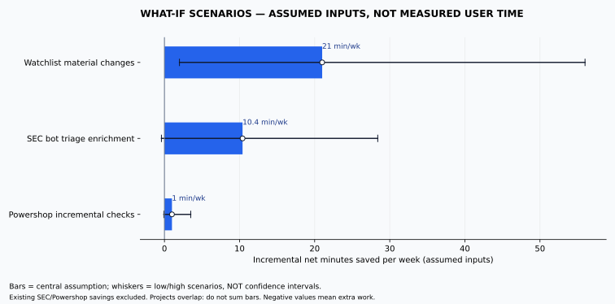

# 自动化机会审计：阶段报告

## 可回答与待回答

历史数据：未提供；没有真实历史问题总数、重复次数、平均每周次数，也没有实测时间。

范围：全部历史为主，最近 90 天用于趋势对照，按新西兰时区统计。当前事实只包括已有 SEC Discord 机器人、Powershop 周二买包，以及聊天主要发生在 chat/work。无法据此声称你在其他主题上投入了多少时间。

目前推荐的是验证顺序，不是用户实际省时排名：先检查现有 SEC 机器人还留下哪些手工筛选；再从历史验证是否经常反复追踪同一股票；Powershop 仅补实际缺口。不要重建已有效的自动化。

**当前四个候选只来自两个已知系统及其邻近假设，不是所有兴趣归纳。** 取得历史后，按[全历史工作流方法](../docs/methodology.md)重新发现需求；新领域可以完全改变现在的候选名单。

## 情景柱状图（不是历史实测）

柱形是中间假设，横线是输入情景范围，不是统计置信区间。负值表示反而多花时间。原始输入见 `../data/scenarios.json`，计算器见 [calculator.html](calculator.html)。

| 候选 | 假设剩余人工核查/周 | 假设净分钟/周：低 / 中 / 高 | 建设分钟（中） | 回本周（中） | 首年扣建设净小时（中） |
| --- | ---: | ---: | ---: | ---: | ---: |
| 关注股票的重要变化摘要 | 7 | 2 / 21 / 56 | 600 | 28.6 | 8.2 |
| 现有SEC机器人的筛选与研究整理 | 6 | -0.4 / 10.4 / 28.4 | 480 | 46.2 | 1.01 |
| Powershop覆盖/购买结果与月初机会检查 | 0.5 | -0.08 / 1 / 3.5 | 480 | 480.0 | -7.13 |

所有数字均未用你的历史验证。核查次数不等于提问次数；不能把 10 条追问简单计为 10 次独立工作。这些项目可能处理同一信息，不能相加。维护、异常和阅读通知均有成本。

模型：`每周净省时 = 剩余人工核查次数 × 可替代比例 ×（手工分钟 − 审核分钟）− 维护 − 异常处理`。

回本只在净省时大于零时成立；首年净收益再扣一次建设投入。开发时长只是预算假设，未验证的接口、反爬、账户限制可能大幅增加成本。

在这些输入下，关注股票的重要变化摘要约28.6周回本；现有SEC机器人的筛选与研究整理约46.2周回本；Powershop覆盖/购买结果与月初机会检查约480.0周回本。建设预算与候选设计中的完整改造范围对应，不假定未知接口可以几分钟接好。由此只能推导：低频的小事可能不值得做新 App，适合补现有脚本或一个提醒。不能据此推导你本人会获得这些收益。

## 候选落地方式

1. **SEC：在现有机器人里加“值得研究的交易”卡片。** 先检查现有功能。只对尚未处理的 P/S 类交易、持股变化、集中买入、修订、计划交易披露做整理。每张卡带原始申报和筛选理由；不把所有 P/S 认定为主观主动买卖，不从申报推导收益保证。目标是少开多个网页核对同一笔交易。
2. **关注股票：按重要变化推送，而非定时泛新闻。** 名单和关注理由一次录入，记录上次状态，抓官方申报与投资者关系消息；财报、指引、稀释等触发差异卡。复用 Discord，一个日汇总，紧急阈值另设；同一事件只通知一次。需要真实历史确认这一工作反复存在。
3. **Powershop：覆盖天数和购买结果的异常提醒。** 核查月初购买、预算、余额/电量、到期和重复购买是否已被现有脚本覆盖。已有周二自动买包不再计入收益。优先补购买后核验、幂等和失败提醒；只有省时达到门槛才做更多界面。没有账户接口前，只能提供方案，不能声称已自动验证或购买。
4. **两个机器人的健康检查。** 仅在漏跑、数据过期、购买结果不确定时提醒，且先检查现有告警。它的价值是避免自动化失效后的返工，当前没有证据把它计成每周省时。

完整设计、数据依赖与 ChatGPT 任务模板：[automation-designs.md](../docs/automation-designs.md)。模板没有被创建为真实定期任务；当前工具没有 ChatGPT 任务创建能力。

## 下一阶段如何产生真实结论

1. 将真实导出放入 `private/`，执行 `python3 -m audit.history private/conversations.json --output private/history-analysis.json`。ZIP 也可直接读；不同账户/工作区的导出覆盖不应混为完整账户历史。
2. 检查导入覆盖、时间缺失、会话分支、分类盲区和每周分布。全历史统计与最近90天分开报告。不会从聊天时间戳推算真实工作分钟。
3. 对重复最多的工作抽取私有证据会话复核；优先利用现有运行日志，或只对最有希望的项目做五次快速计时校准（可选）。没有计时也可以用明确区间提供方案，不要求额外长期填日志。旧历史不能补测的分钟数保持估算。
4. 给每个动作一个唯一 ID，处理候选覆盖重叠，扣除现有自动化，才能计算组合收益。先试运行一个项目；达到实际净省时门槛后才上线。

## 尚未完成

全历史工作归纳、真实低效事项排名、实测耗时柱状图、定期任务创建、线上运行均未完成。当前完成的是可复现的本地分析工具、候选设计、透明收益情景、版本化进度。导入数据后的主题次数也不能当作已测耗时。原始对话及逐条私有证据不提交 GitHub。
